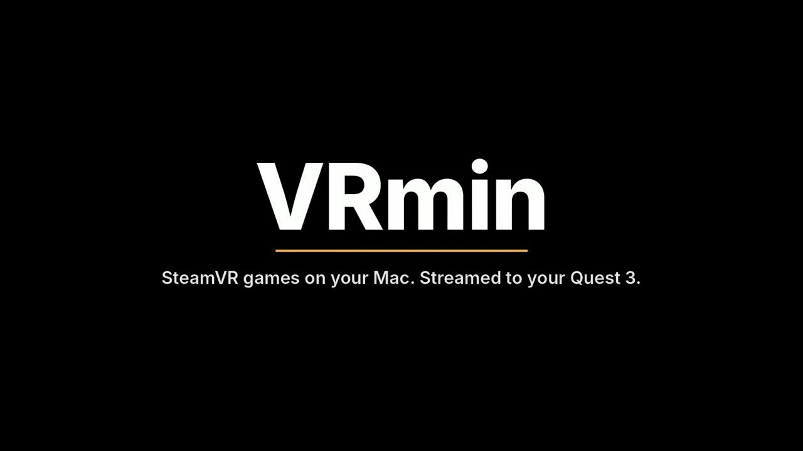
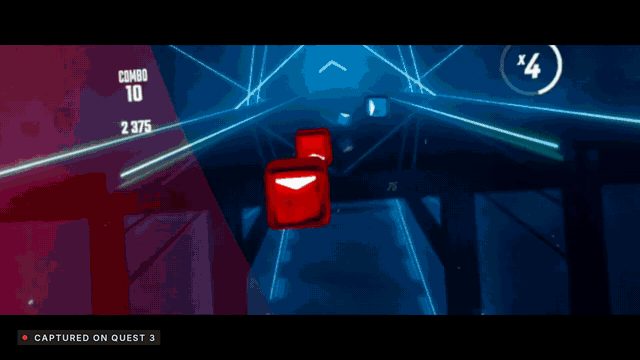
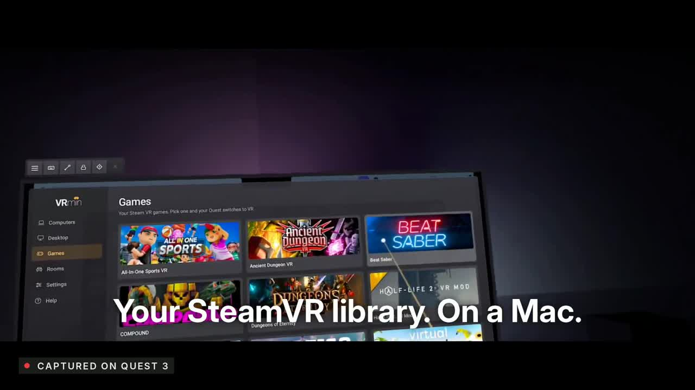
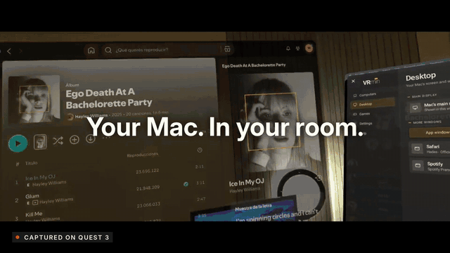
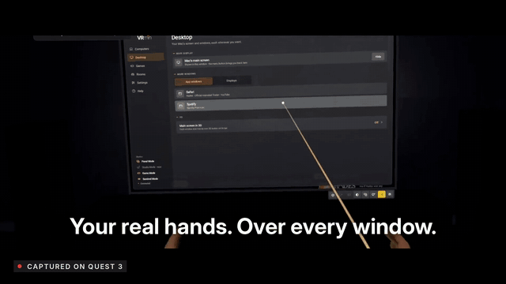
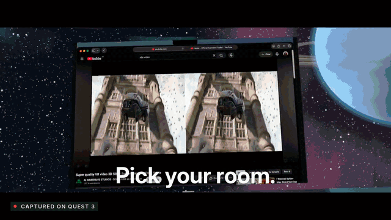
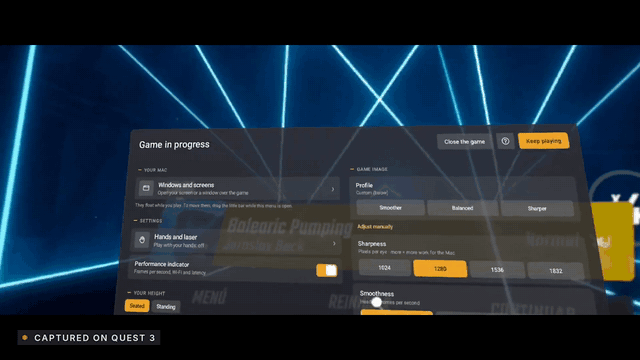
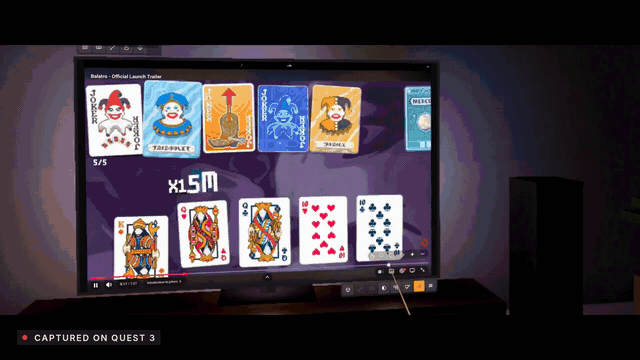
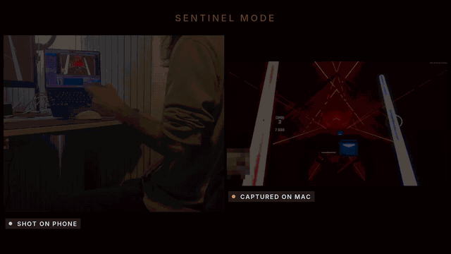

<div align="center">



# VRmin

**Play your SteamVR games on a Mac. Streamed to your Meta Quest.**

Free and open source · Apple Silicon Mac + Meta Quest 3 / 3S + Steam

[**Download**](../../releases/latest) · [How it works](#how-it-works) · [Install](#install) · [FAQ](#faq) · [☕ Support on Ko-fi](https://ko-fi.com/thevermin)



</div>

> [!NOTE]
> **Yes, VRmin is vibe-coded.** It was built by describing what I wanted to an AI (Claude) and testing every
> version on my own Mac and Quest. [More about that below.](#a-note-on-vibe-coding)

---

## What is VRmin?

Macs can't run SteamVR games. VRmin makes it happen: it runs the **Windows version** of your Steam VR games on your
Mac (using Wine and a Metal translation layer), and streams the picture to your **Meta Quest** over Wi‑Fi, with your
head and hand movements going back the other way.

It is two apps that work together:

| | App | What it does |
|---|---|---|
| 💻 | **VRmin Host** (Mac) | Installs and runs Steam for Windows, opens your VR games, and streams them (plus your Mac's screen, windows and sound) to the headset. |
| 🥽 | **VRmin** (Quest) | Your virtual room: the game stream, your Mac's desktop and windows, menus, hands and controllers. |

## Features

### 🎮 SteamVR games on your Mac
Your SteamVR library, running on Apple Silicon. Tested with games like **SUPERHOT VR** and **Beat Saber**.
VRmin picks the right VR runtime for each game automatically (OpenXR directly, or OpenVR through OpenComposite).



### 🖥️ Your Mac in your room
Your whole desktop, or any single window, floating wherever you want. Watch, browse and work on a giant screen.



### ✋ Your real hands, over every window
Hand tracking with your real (passthrough) hands, so you always see what you're doing. Controllers are always visible
too. Touch windows directly, or point with the laser.



### 🌌 Pick your room
A living room, space, a cinema… or mixed reality with your real desk still there.



### ⚙️ Game settings without leaving the game
Quality, sharpness, frame rate, codec and more, per game, from a menu inside VR.



### 🚪 Need the real world? Draw a portal
Draw a circle in the air with your hand and see through to your real room (and pet your cat).



### 🛋️ Sentinel Mode: play without wearing the headset
Put the Quest on your monitor: it tracks you with its cameras while the game shows on your Mac's screen.



### And more
- **Flat games** on a giant screen, and **side‑by‑side 3D videos** that pop with one tap
- **Direct GPU copy**: game frames go from the game to the video encoder without leaving the GPU
- **Foveated encoding**: sharper in the center, where you look
- **Your Mac's sound** in the headset, and the **headset keyboard** types on your Mac
- English and Spanish

## How it works

```
 Steam VR game (Windows)                                            Meta Quest
        │                                                               ▲
   Wine + DXMT ── DirectX 11 → Metal                                    │ H.265 / H.264 video + sound (Wi‑Fi)
        │                                                               │
 VRmin OpenXR runtime ── frames (shared GPU textures) ──► VRmin renderer (Mac) ── encoder
        ▲                                                               │
        └──────────────── head & hand tracking ◄────────────────────────┘
```

## Requirements

- A Mac with **Apple Silicon** (M1 or newer), **macOS 14.2** or newer, and Rosetta 2
- A **Meta Quest 3 or 3S** (Quest 2 and Pro may work, without some mixed‑reality features)
- The Mac and the Quest on the **same Wi‑Fi** network (5/6 GHz, or the Mac on Ethernet, works best)
- A Steam account with your VR games, and space for them (VRmin installs its own Steam for Windows: games are
  downloaded again there)

## Install

### 1. On your Mac
1. Download **`VRmin Host <version>.zip`** from [Releases](../../releases/latest) and double‑click it.
2. Drag **VRmin Host** to your **Applications** folder.
3. The first time, **right‑click → Open** (macOS warns because the app isn't from the App Store). On newer macOS
   versions, if it still won't open, go to **System Settings → Privacy & Security** and click **Open Anyway**.
4. In VRmin Host, click **Install** next to *Windows games engine*, then **Install** next to *Steam*.
5. Open Steam from VRmin Host, sign in, and download your VR games.
6. macOS will ask for **Screen Recording** (to show your desktop and windows) and **Accessibility** (for the pointer
   and keyboard) permissions.

### 2. On your Quest
1. Turn on [developer mode](https://developers.meta.com/horizon/documentation/native/android/mobile-device-setup/)
   on your Quest.
2. Download **`VRmin-<version>.apk`** from [Releases](../../releases/latest) and install it with
   [SideQuest](https://sidequestvr.com) (or `adb install VRmin-<version>.apk`).
3. Find it in **Library → Unknown sources → VRmin**.

Once VRmin Host is set up, it can also install and update the Quest app for you: turn on **Sentinel Mode**'s tools
in VRmin Host, connect the Quest with a USB-C cable and click **Install** next to *Quest app*.

### 3. Play
Open **VRmin Host** on the Mac and **VRmin** on the Quest. The Quest finds your Mac by itself: pick it and connect.
Choose a game from the **Games** tab, and play.

### Updates
VRmin Host checks for new versions by itself: when there's one, click **Update** at the top. The Quest app updates
from VRmin Host too, over the USB-C cable.

## FAQ

**Which games work?**
Many SteamVR games that use DirectX 11 work, but not all of them. VRmin Host shows what it detected for each game and
lets you try another VR runtime. Games with anti‑cheat, or that need DirectX 12 or Vulkan, usually don't work yet.

**How much latency is there?**
Around 50–60 ms from your head moving to the picture changing, on a good 5 GHz Wi‑Fi network. The first minutes
of a game are slower while it prepares its graphics.

**Is it safe? Does it touch my games?**
VRmin doesn't modify or redistribute game files. It downloads Wine, DXMT, OpenComposite and the official Steam
installer on your Mac, and it doesn't collect any data.

**Something doesn't work.**
Click **"Something's wrong"** in VRmin Host (it collects the logs into a .zip on your Desktop) and open an
[Issue](../../issues) with it.

## A note on vibe coding

I'll be honest: nobody likes vibe-coded projects, and deep down I'm the first one to hate on them. But sometimes
people need a tool that nobody else is willing to make. Mac users have waited years to play SteamVR games, and no one
was going to build this for us. That's the idea VRmin was born from.

So VRmin was written with AI, and tested for hours on real hardware, one game at a time. It is open source so
anyone can read every line, check what it does, and make it better. If you find something ugly, a pull request is
very welcome.

## Building from source

See [docs/BUILDING.md](docs/BUILDING.md).

## Support

VRmin is free. If you enjoy it, you can buy me a coffee: **[☕ ko-fi.com/thevermin](https://ko-fi.com/thevermin)**

## License

VRmin © 2026 thevermin, licensed under the [GNU GPL v3.0](LICENSE) with additional terms
([NOTICE.md](NOTICE.md)): if you share a modified version, keep it open source under the same license, credit the
original (**"Based on VRmin by thevermin"**, with a link to this repository) and use a different name and logo.

Third‑party software: [third-party notices](mac/app/recursos/LICENCIAS_DE_TERCEROS.md). VRmin is an independent project, not
affiliated with Meta, Valve or Apple.
